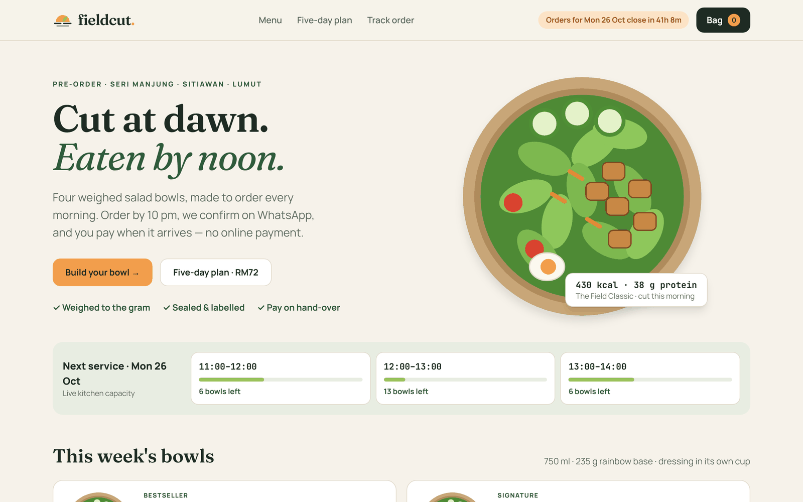
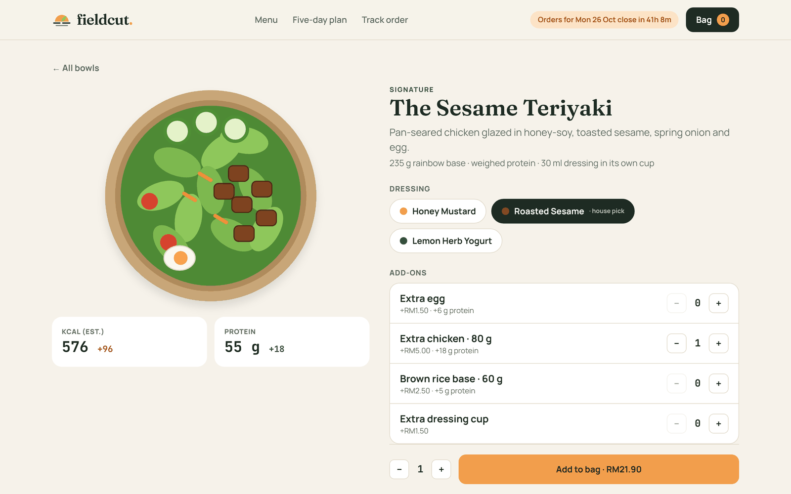
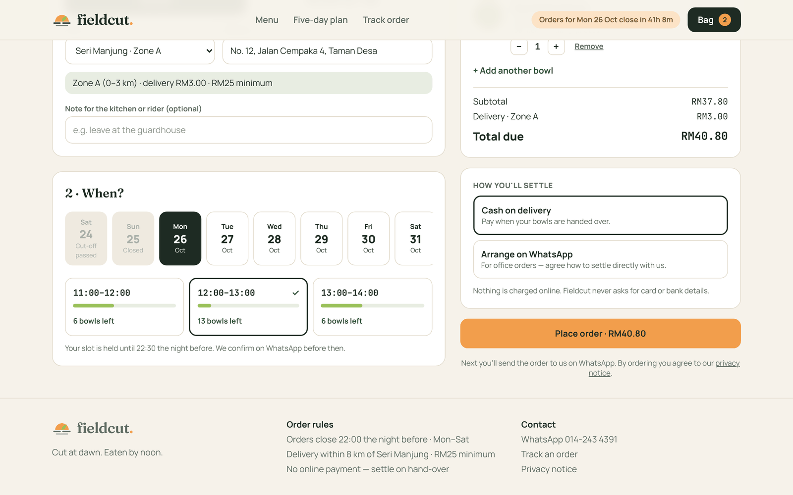
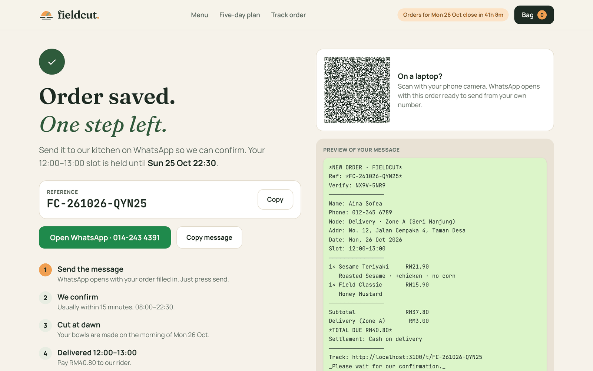
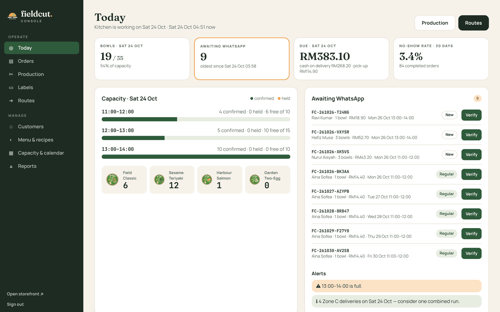
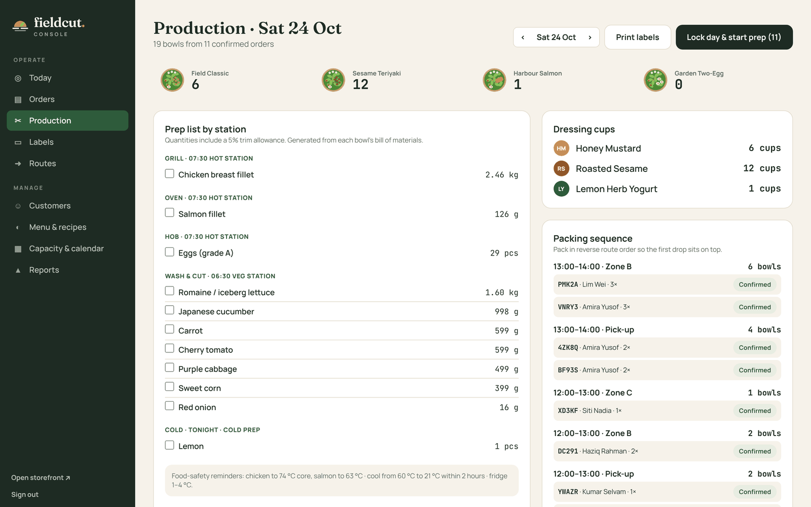
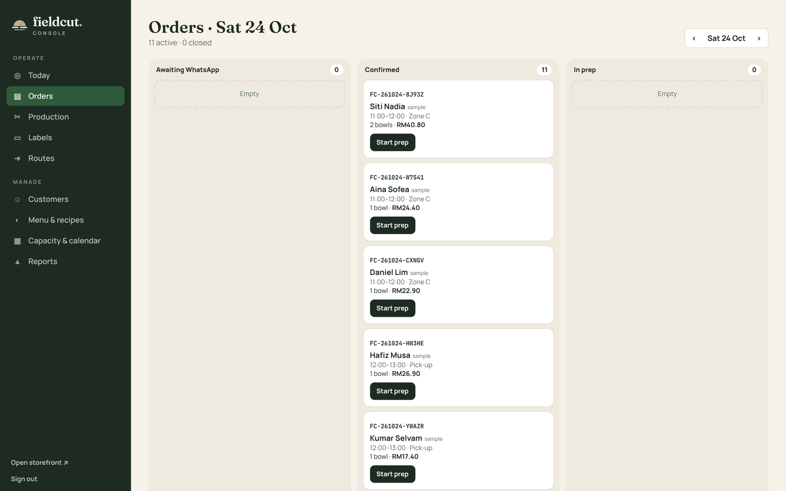
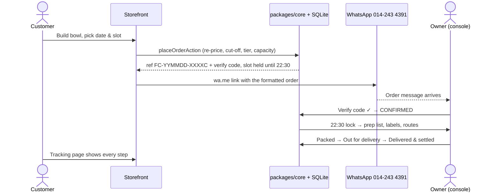

<div align="center">

# Fieldcut OS

**Pre-order and kitchen-operations platform for a home-based salad kitchen.**
Customers build a bowl, book a delivery slot the kitchen can really make, and send a tamper-evident order to WhatsApp.
The owner verifies it, and the system turns tomorrow's orders into a weighed prep list, thermal labels and delivery routes.
**No online payment, by design.**

**[Live demo → fieldcut-os.vercel.app](https://fieldcut-os.vercel.app)** · kitchen console at [/console](https://fieldcut-os.vercel.app/console) (demo password `fieldcut`)

     



</div>

---

## Why this exists

Home food sellers in Malaysia usually take orders through WhatsApp DMs: items go missing, totals are wrong, and nobody knows how many bowls tomorrow really is. Fieldcut OS keeps WhatsApp as the conversation, but puts a real system behind it:

| Problem | What Fieldcut OS does |
|---|---|
| Free-text orders, wrong totals | Structured order, server-side pricing in integer sen, formatted WhatsApp message |
| Overselling the kitchen | Live slot capacity, reserved atomically in a database transaction |
| Fake or edited orders | Reference with a check character + HMAC verify code checked by the owner |
| No-shows without prepayment | Trust tiers: order limits grow with completed orders; two no-shows pause a number |
| Counting ingredients by hand at 22:30 | Prep engine explodes each bowl's bill of materials into a weighed prep list |
| Messy deliveries | Route board by slot and zone, one-tap WhatsApp "on the way", settle on hand-over |

## Features

**Storefront** — menu with live kitchen capacity · bowl builder (dressing swap, add-ons, leave-outs) with live kcal, protein and price · checkout with zone fee, date strip and slot picker · WhatsApp hand-off with QR code for desktop · order tracking protected by the phone's last 4 digits · five-day plan (RM72) · bilingual-ready copy, mobile first.

**Kitchen console** — Today dashboard · order board that mirrors the state machine · order detail with verify-code check, event log and WhatsApp reply templates · production board (prep list by station, dressing cups, packing sequence, lock day) · printable 50 × 30 mm thermal labels · route board with settlement · menu prices and availability · capacity calendar and closed days · customers and trust tiers · reports (bowls per day, mix, repeat rate, time to confirm, no-show rate) · one-click sample data.

<table>
<tr>
<td></td>
<td></td>
</tr>
<tr>
<td></td>
<td></td>
</tr>
<tr>
<td></td>
<td></td>
</tr>
</table>

## How an order flows



Order status is a state machine — `SUBMITTED → CONFIRMED → IN_PREP → PACKED → OUT_FOR_DELIVERY / READY_FOR_PICKUP → COMPLETED`, with `EXPIRED`, `CANCELLED` and `NO_SHOW` as exits. Illegal moves are rejected in one place and every change is appended to `order_events`.

## Architecture

```
fieldcut-os/
├── apps/web/                 Next.js 16 app (storefront + console)
│   ├── app/(store)/          /, /menu/[slug], /checkout, /order/[ref], /t/[ref], /plan, /track
│   ├── app/console/          login, today, orders, production, labels, routes, menu, capacity, customers, reports
│   ├── actions/              Server Actions (validate → core → db)
│   ├── server/               SQLite (node:sqlite), repository, auth, HMAC verify codes
│   ├── components/           UI (design tokens from the brand)
│   └── lib/                  client bag (localStorage, choices only — never prices)
├── packages/core/            Pure domain logic, zero framework imports, unit-tested
│   └── src/                  catalog · pricing · zones · time · slots · machine · reference · relay · prep · trust
├── e2e/                      Playwright end-to-end tests
└── docs/                     architecture, ADRs, screenshots
```

- **Modular monolith** — one deployable app, with business rules isolated in `packages/core` so they can be tested in milliseconds and reused anywhere.
- **The server is the source of truth** — the browser sends choices; prices, cut-off, capacity and tier limits are recomputed on the server.
- **Cache Components** — pages ship a static shell instantly and stream live data (capacity, orders) inside `<Suspense>`.

Read more in [docs/architecture.md](docs/architecture.md) and the [decision records](docs/adr).

## Tech stack

TypeScript (strict) · Next.js 16 App Router with Server Actions and Cache Components · React 19 · Tailwind CSS 4 · SQLite through Node's built-in `node:sqlite` · Node's test runner for unit tests · Playwright for end-to-end tests · GitHub Actions CI · pnpm workspaces.

## Run it locally

Requirements: Node.js **22.18+** (24 recommended) and pnpm.

```bash
git clone https://github.com/amrasy9am-sudo/fieldcut-os.git
cd fieldcut-os
pnpm install
pnpm dev
```

- Storefront: http://localhost:3000
- Console: http://localhost:3000/console — development password `fieldcut`
- In the console, **Reports → Load sample orders** fills every screen with realistic data.

The database is created automatically in `apps/web/.data/`. Reset it with `pnpm db:reset`.

### Configuration

Copy `apps/web/.env.example` to `apps/web/.env.local`:

| Variable | Purpose |
|---|---|
| `CONSOLE_PASSWORD` | Console password, 6+ characters (required in production) |
| `ORDER_SIGNING_SECRET` | Signs verify codes and sessions. Optional: if unset in production, a random key is generated on first start and kept in the data folder |
| `PUBLIC_BASE_URL` | Base URL used in tracking links inside WhatsApp messages. Falls back to `RAILWAY_PUBLIC_DOMAIN`, then the request host |
| `FIELDCUT_DATA_DIR` | Folder for the SQLite database and generated key. Defaults to `apps/web/.data` |
| `FIELDCUT_DEMO` | `1` turns on public-demo mode: a banner, the console password on the sign-in page, and sample orders loaded into an empty database |

## Deploy

The repository ships a `Dockerfile`, so it runs on any host with a persistent disk. SQLite needs that disk, so serverless platforms are not a fit (see the roadmap).

**Vercel: free public demo**

Import the repository on Vercel, set **Root Directory** to `apps/web`, and add `FIELDCUT_DEMO=1`. Only `/tmp` is writable on Vercel, so each serverless instance keeps its own sample database that resets when the instance is recycled. Demo mode also falls back to the console password `fieldcut` and a signing key derived from the project ID. Use it for the portfolio demo only.

**Render: free public demo**

`render.yaml` is a Blueprint for the free plan in Singapore with demo mode on. New → Blueprint → pick this repository → Apply. The free plan sleeps after 15 minutes idle and has no disk, so the database resets on wake and demo mode reloads sample orders.

**Railway, or Render with a disk: real use**

1. Deploy the repository as a Docker service. Both hosts detect the `Dockerfile`.
2. Attach a persistent **volume / disk** mounted at `/data`. Orders and the signing key live there and survive redeploys.
3. Set `CONSOLE_PASSWORD` to your own password, and leave `FIELDCUT_DEMO` unset.
4. Give the service a public domain.

**Any Docker host**

```bash
docker build -t fieldcut-os .
docker run -p 3000:3000 -v fieldcut-data:/data -e CONSOLE_PASSWORD=your-password fieldcut-os
```

## Scripts

| Command | What it does |
|---|---|
| `pnpm dev` | Run the app in development |
| `pnpm test` | Unit tests for the domain package |
| `pnpm typecheck` | TypeScript across the workspace |
| `pnpm lint` | ESLint |
| `pnpm build` | Production build |
| `pnpm e2e` | End-to-end tests (needs a running server) |

## Business rules (from the business proposal)

- Orders close **22:00 the night before**; unconfirmed orders release their slot at **22:30**.
- Monday–Saturday; book up to 7 days ahead (plans 14).
- Delivery within 8 km of Seri Manjung: Zone A RM3 · B RM5 · C RM7, RM25 minimum. Pick-up is free.
- Trust tiers: New (max RM60, one open order) · Regular · Trusted · Paused after two no-shows.
- Five-day plan: RM72 for five bowls, salmon days +RM8, free delivery in Zones A and B.

## Roadmap

- [x] Storefront, WhatsApp hand-off, tracking, five-day plan
- [x] Console: verify & confirm, production, labels, routes, capacity, customers, reports
- [ ] Postgres adapter for serverless hosting (repository already isolates SQL)
- [ ] Bahasa Melayu translations for the storefront
- [ ] Staff roles (packer, rider) with passkey sign-in
- [ ] WhatsApp Cloud API notifications (opt-in)

## About

Built by **Mohamad Amirul Asyraf** as the operating system for Fieldcut Kitchen, a pre-order salad-bowl brand in Seri Manjung, Perak. The business plan and full product specification are in the Fieldcut Business & Platform Proposal.

© 2026 Mohamad Amirul Asyraf. All rights reserved. Source shared for portfolio viewing only; not licensed for reuse. See [LICENSE](LICENSE).
