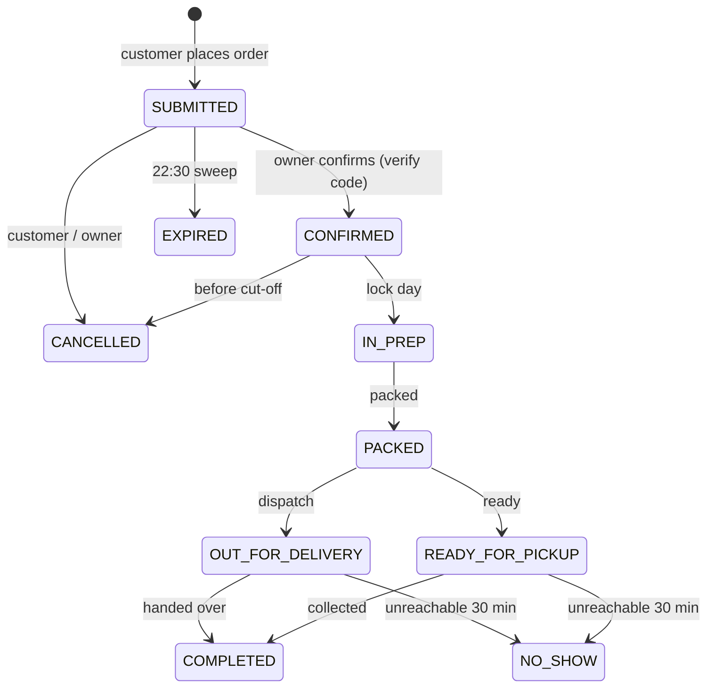

# Architecture

Fieldcut OS is a **modular monolith**: one Next.js application with the business rules in a separate, framework-free package.

```
Browser ──► Next.js App Router (apps/web)
              ├─ Server Components  — read data at request time inside <Suspense>
              ├─ Server Actions     — every mutation; validate input → call core → write
              └─ server/            — SQLite repository, auth, HMAC
                     │
                     ▼
            packages/core (pure TypeScript, no I/O)
              pricing · zones · time & cut-off · slots & capacity · order state machine
              reference numbers · WhatsApp message rendering · prep engine · trust tiers
```

## Layers

| Layer | Responsibility | Rules |
|---|---|---|
| `packages/core` | Business rules | No framework imports, no I/O, 100% deterministic, unit-tested with `node --test` |
| `apps/web/server` | Persistence and security | Only module that touches SQLite; every write in a transaction |
| `apps/web/actions` | Mutations | Parse untrusted `FormData`, check auth, call repository, `refresh()` |
| `apps/web/app` | Pages | Async Server Components read data after `requestNow()` inside `<Suspense>` |
| `apps/web/components` | UI | Client components only where interaction needs it |

## Data model

Ten SQLite tables (`apps/web/server/db.ts`): `menu_items`, `slots`, `slot_overrides`, `closed_dates`, `customers`, `orders`, `order_items`, `order_events`, plus indexes on `(slot_date, status)`, `(customer_id, created_at)` and `plan_ref`.

- Money is stored as **integer sen**.
- Time is stored as **UTC ISO strings**; dates as `YYYY-MM-DD` in Malaysian time (UTC+8, no DST).
- Order items keep the **price at time of order**; later menu changes never rewrite history.
- `order_events` is **append-only** and powers the tracking page, the audit log and "time to confirm".
- Capacity is derived (`SUM(bowls)` per date and slot over active statuses), never stored as a counter that can drift.

## Order lifecycle



Settlement (`UNSETTLED → SETTLED / WAIVED`) is a separate field: money is not a status.

## Security

| Threat | Control |
|---|---|
| Price tampering | Browser sends item choices only; the server re-prices from the database |
| Edited WhatsApp message | HMAC-SHA256 verify code over the canonical order; console compares the typed code |
| Fake orders blocking capacity | Unconfirmed holds expire at 22:30; trust-tier limits for new numbers |
| Double submit | Idempotency key per checkout; unique index on `orders.idem_key` |
| Console access | Password + HMAC-signed, httpOnly session cookie; every console action calls `requireOwner()` |
| Customer privacy | Tracking requires the phone's last 4 digits (or the device that placed the order); console masks phone numbers in lists |
| Secrets | `ORDER_SIGNING_SECRET` and `CONSOLE_PASSWORD` are required in production; the app refuses to run without them |

## Rendering with Cache Components

Next.js 16 prerenders a static shell for every route. Anything that depends on the request or on the database is read inside an async component wrapped in `<Suspense>`, after `requestNow()` (which awaits `connection()` and runs the hold sweep). Synchronous `node:sqlite` reads therefore never end up baked into the static shell.
